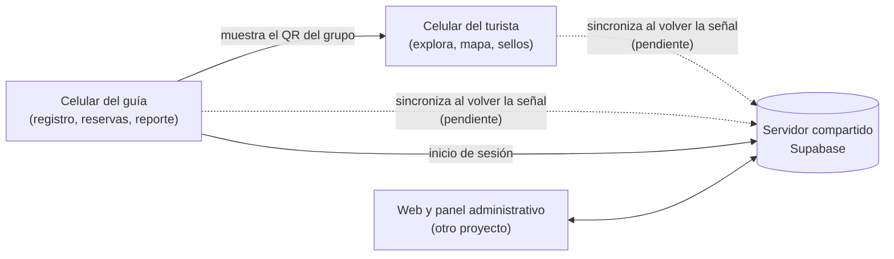

# Estado y avances del proyecto

**App móvil del explorador ecoturístico del bosque seco** · Reto 12 de AIDER ·
Hackathon Piura Innova 2026

> **Para quién es este documento:** para el equipo de soluciones y para
> cualquier persona que necesite entender qué hace la app hoy, cómo está
> pensada y qué falta, sin leer código.
>
> **Última actualización:** 11 de octubre de 2026.
>
> **Para comentar:** citen el código de la fila (por ejemplo, *T3* o *D4*).
> Así sabemos exactamente a qué se refieren.

Otros documentos, más detallados:
[`PRODUCTO.md`](PRODUCTO.md) (alcance y reglas del negocio),
[`ARQUITECTURA.md`](ARQUITECTURA.md) (detalle técnico) y
[`demo/GUION.md`](demo/GUION.md) (guion de la presentación).

---

## 1. La app en pocas palabras

Una app para celular que hace dos cosas:

1. **Para el turista:** le muestra qué hay en el bosque seco, cuánto cuesta y
   cómo contactar a los guías por WhatsApp. Dentro del bosque, **sin señal**,
   le muestra la ruta en un mapa y le da un sello por cada punto que visita;
   los sellos suman puntos para descuentos en productos de la comunidad.
2. **Para la asociación (puesto de control):** reemplaza el **cuaderno de
   visitas**. El guía registra a cada grupo en el celular, la app genera un QR
   para el grupo, avisa si alguien no ha salido del bosque y arma el resumen
   del día con datos que AIDER puede usar.

La idea de fondo: *si la comunidad gana más con el turismo que con la tala,
conserva el bosque.* Cada visita registrada es un dato para conseguir fondos y
cada sello es una posible venta para la comunidad.

Esta app es **una parte** de la solución. La web informativa y el panel
administrativo (donde se cargan rutas, tarifas y se descarga el PDF oficial)
los hace el equipo web, en otro proyecto que comparte la misma base de datos.



---

## 2. Resumen del avance

| | Cantidad |
|---|---|
| ✅ Funcionalidades terminadas | 16 |
| 🟡 Funcionalidades a medias | 3 |
| ⏳ Funcionalidades pendientes | 3 |

Lo más importante que **ya funciona**: el registro de grupos que reemplaza al
cuaderno, el escaneo de QR con la cámara, el mapa con GPS sin señal, las
reservas, el cierre del día y que **todo queda guardado en el celular** aunque
se cierre la app.

Lo más importante que **falta**: que la app **envíe** lo guardado al
servidor cuando vuelve la señal (sincronización). Hoy todo se queda en el
celular y se muestra como "pendiente de sincronizar".

---

## 3. Funcionalidades y su estado

Leyenda: ✅ Hecha · 🟡 En parte · ⏳ Pendiente. "Datos de ejemplo" significa
que funciona, pero con información inventada para la demo hasta que la
asociación cargue la real en el portal web.

### Modo turista

| Código | Qué hace | Estado | Notas |
|---|---|---|---|
| T1 | **Explorar el lugar:** ficha "Antes de ir" (medios de pago, si hay señal, cómo llegar), atractivos con imagen y servicios con tarifa referencial. | ✅ Hecha | Datos de ejemplo de El Angolo. Las imágenes son ilustraciones; se cambian por fotos reales con el mismo nombre. |
| T2 | **Contactar por WhatsApp:** un botón abre el chat del servicio con el mensaje ya escrito. | ✅ Hecha | Hoy todos los servicios usan un número de ejemplo. |
| T3 | **Vincular el celular al grupo:** el turista escanea el QR que le muestra el guía. | ✅ Hecha | Usa la cámara. Si no lee, se puede escribir el código. |
| T4 | **Llevarse la información para usarla sin señal.** | 🟡 En parte | Hoy la información ya viene dentro de la app y funciona sin señal, pero todavía no se descarga del servidor. |
| T5 | **Mapa de la ruta:** puntos con su estado, el siguiente punto con distancia y tiempo a pie, y la ubicación por GPS (funciona sin señal). | ✅ Hecha | Coordenadas de ejemplo. El mapa de fondo (calles, relieve) es opcional; sin él se ve la ruta sobre fondo liso. |
| T6 | **Sello por punto:** al escanear el cartel de un punto gana un sello y 1 punto. Escanear dos veces no suma de nuevo. | 🟡 En parte | El sello funciona sin señal. Faltan las fotos y el audio de cada punto. |
| T7 | **Pasaporte:** sellos conseguidos, pendientes y por visitar, y puntos disponibles. | ✅ Hecha | |
| T8 | **Canje de puntos** por descuentos en productos de la comunidad. | 🟡 En parte | Se canjea con confirmación y se descuentan los puntos. Falta el cupón con QR para mostrar en la tienda. |
| T9 | **Opinión al salir** e insignia para compartir. | ⏳ Pendiente | Es opcional. |
| T10 | **Ajustes:** idioma (español o inglés) y apariencia (clara, oscura o la del celular). | ✅ Hecha | También muestra si hay conexión con el servidor. |

### Modo puesto de control (asociación y guías)

| Código | Qué hace | Estado | Notas |
|---|---|---|---|
| A6 | **Entrar con la cuenta de la asociación.** Solo la primera vez necesita señal; después entra sin internet. | ✅ Hecha | Sin servidor se usa una cuenta de prueba. |
| A7 | **El guía toca su nombre** ("¿Quién eres?"). Cada grupo queda a nombre del guía que lo registró. La próxima vez: "Continuar como…". | ✅ Hecha | Los nombres de los guías son de ejemplo; falta la lista real en el servidor. |
| A1 | **Registrar un grupo** en una sola pantalla: nombre, DNI (o pasaporte y país), edad y procedencia de cada persona; actividades y hora prevista de salida. Genera **un solo QR** para todo el grupo. | ✅ Hecha | Pide los datos que exige el SERNANP. |
| A2 | **Ver quién está dentro**, volver a mostrar el QR de un grupo y marcar su salida (con confirmación). | ✅ Hecha | |
| A3 | **Alerta "sigue dentro"** cuando un grupo pasa su hora de salida. | ✅ Hecha | |
| A9 | **Reservas:** anotar quién viene, día, hora y cuántas personas; reprogramar o cancelar. Cuando el grupo llega, "Llegaron" abre el registro de siempre. | ✅ Hecha | Muestra las reservas retrasadas y las que no llegaron. |
| A4 | **Reporte del día:** visitantes, grupos, procedencia, edades y detalle por guía. **Descargar PDF** lo crea en el celular, sin señal, y lo comparte por WhatsApp o lo guarda. | ✅ Hecha | El panel web también podrá generar el consolidado de todas las asociaciones. |
| A8 | **Cerrar el día:** deja constancia de quién cerró y a qué hora, y avisa si hay grupos sin salida. | ✅ Hecha | Si algo cambia después del cierre, avisa que hay que actualizarlo. |
| A5 | **Validar cupones** de canje escaneando su QR. | ⏳ Pendiente | Depende del cupón con QR (T8). |

### Para todos

| Código | Qué hace | Estado | Notas |
|---|---|---|---|
| G1 | **Todo se guarda en el celular** (grupos, reservas, sellos, cierres) y sigue ahí al cerrar la app. | ✅ Hecha | Es la base para funcionar sin señal. |
| G2 | **Sincronización:** enviar al servidor lo guardado en el celular cuando vuelve la señal, sin duplicar. | ⏳ Pendiente | Las tablas ya están propuestas al equipo web. Falta que la app las use. |
| G3 | **Pensada para usar al sol y por personas con poca experiencia digital:** buen contraste, botones grandes, letra que se puede agrandar sin que se rompa la pantalla, compatible con lectores de pantalla. | ✅ Hecha | Se revisa automáticamente en cada cambio. |

---

## 4. Cómo está construida (sin tecnicismos)

### Funciona primero en el celular

Dentro del bosque no hay señal. Por eso la app **guarda todo primero en el
celular** y lo trata como la información verdadera. El servidor solo sirve
para compartir esos datos con el panel web cuando hay internet.

- Cada registro nace en el celular con su propio código único. Si se envía
  dos veces por una mala conexión, el servidor lo reconoce y **no lo
  duplica**.
- La app siempre muestra si algo está **pendiente** (solo en el celular) o
  **confirmado** (ya llegó al servidor).
- Solo los puntos **confirmados** se pueden canjear, para evitar trampas.

### Ordenada por módulos

Cada funcionalidad (explorar, mapa, escaneo, pasaporte, visitas, reservas,
reportes, sesión, ajustes) es un **módulo independiente**. Así cada integrante
del equipo trabaja en su parte sin pisar la de otro.

Dentro de cada módulo hay cuatro partes, siempre con la misma función:

| Parte | Qué hace | Ejemplo en el registro de grupos |
|---|---|---|
| **Pantalla** | Lo que se ve. Solo dibuja y recibe los toques. | El formulario con nombre, DNI y edad. |
| **Coordinador** | Recibe lo que tocó la persona y decide qué mostrar. | Al tocar "Registrar grupo", junta los datos y pide guardarlos. |
| **Reglas del negocio** | Lo que no puede fallar, escrito una sola vez y probado. | "El DNI peruano tiene 8 dígitos", "la salida no puede ser antes de la entrada". |
| **Datos** | De dónde sale y dónde se guarda la información. | Hoy en el celular; mañana también en el servidor. |

La ventaja: pasar de datos de ejemplo a datos reales solo cambia la parte de
**datos**. Las pantallas y las reglas no se tocan.

Esta forma de organizar la app es la que recomienda el propio equipo de
Flutter. El equipo la eligió frente a otras opciones porque se prueba fácil y
no exige escribir código de más en el tiempo del hackathon (detalle en
[`ARQUITECTURA.md`](ARQUITECTURA.md)).

---

## 5. Herramientas que usamos

| Herramienta | Para qué la usamos |
|---|---|
| **Flutter** (versión 3.38.9) | Construir la app una sola vez para Android y iPhone. |
| **Supabase** | El servidor compartido con el proyecto web: base de datos y cuentas de las asociaciones. |
| **Memoria del celular** (`shared_preferences`) | Guardar grupos, reservas, sellos, cierres, idioma y apariencia sin internet. |
| **Mapas** (`flutter_map`) y **GPS** (`geolocator`) | Dibujar la ruta y ubicar al turista. El GPS funciona sin señal. |
| **Lector de QR** (`mobile_scanner`) | Leer con la cámara el QR del grupo y los carteles de los puntos. |
| **Generador de QR** (`qr_flutter`) | Crear el QR único de cada grupo. |
| **Enlaces externos** (`url_launcher`) | Abrir WhatsApp con el mensaje ya escrito. |
| **PDF** (`pdf`, `printing`) | Crear el reporte del día en el celular y compartirlo. |
| **Estado de la red** (`connectivity_plus`) | Saber si hay señal para avisar qué falta sincronizar. |
| **Traducciones** (`flutter_localizations`) | Tener toda la app en español e inglés. |
| **Riverpod** y **go_router** | Ordenar internamente los datos de cada pantalla y la navegación entre pantallas. |
| **GitHub** | Guardar el código y trabajar en equipo. Cada funcionalidad se desarrolla aparte y se revisa antes de unirla. |
| **GitHub Actions** | Revisión automática en cada cambio (ver sección 7) y generación del instalador de Android (APK). |
| **Claude Code** | Asistente de programación con instrucciones del proyecto para respetar estas reglas. |
| **PlantUML** | Diagramas del flujo de la visita, del registro y del modelo de datos ([`diagramas/`](diagramas)). |

---

## 6. Decisiones tomadas y por qué

| Código | Decisión | Por qué |
|---|---|---|
| D1 | La app guarda todo primero en el celular y sincroniza después. | Dentro del bosque no hay señal; la app no puede depender de internet. |
| D2 | **Un solo QR por grupo**, no uno por persona. | Es más rápido en el puesto de control en temporada alta. Quien hace otras actividades se registra como otro grupo. |
| D3 | El turista **no crea cuenta**: se vincula escaneando el QR del grupo. | Menos pasos y nada de contraseñas para alguien de paso. |
| D4 | Una **cuenta por asociación**, compartida por sus guías; cada guía toca su nombre al entrar. | Es como trabajan hoy (un celular compartido) y cada grupo queda a nombre del guía que lo atendió. |
| D5 | La sesión de la asociación **no se cierra por falta de señal**. | El puesto puede quedarse sin internet; el guía no debe quedarse fuera de la app. |
| D6 | Se piden **DNI, edad y procedencia** de cada persona, y pasaporte y país si es extranjera. | Es lo que exige el protocolo del SERNANP y lo que necesita el reporte. |
| D7 | Una reserva, al llegar el grupo, **se convierte en registro** con un toque. | No se escriben los datos dos veces y la reserva queda ligada a la visita real. |
| D8 | El **consolidado** de todas las asociaciones lo genera el panel web. | La oficina trabaja en la web con todos los datos juntos (el PDF de cada día también sale de la app, ver D16). |
| D9 | Sin pagos en línea: el contacto es por **WhatsApp**. | Es como ya trabajan las comunidades y evita costos y trámites de pasarelas de pago. |
| D10 | Sin servidor configurado, la app arranca con **datos de ejemplo** y una cuenta de prueba. | La demo funciona aunque falle internet en la presentación. |
| D11 | **Español e inglés**, modo claro y oscuro, buen contraste y botones grandes. | Llegan turistas extranjeros y la app se usa al sol, por personas con poca experiencia digital. |
| D12 | Las tablas nuevas del servidor usan **nombres en inglés**, como las que ya creó el equipo web. | Una sola convención para los dos proyectos. |
| D13 | Los datos personales (DNI, edad) **solo los ve la asociación dueña** del registro. | Protección de datos personales. Ya está considerado en el diseño de las tablas. |
| D14 | Versiones de herramientas **fijas** para todo el equipo. | Evita que la app funcione en una laptop y falle en otra o en la revisión automática. |
| D16 | La app **también genera el PDF del día**, sin señal (criterio C3 de AIDER). | El puesto de control no siempre tiene internet; el guía puede enviar el reporte por WhatsApp apenas cierra el día. El panel web sigue siendo el lugar del consolidado. |
| D15 | La app se organiza por **módulos** con cuatro partes cada uno (sección 4). | Se prueba fácil, cada integrante trabaja en su módulo y cambiar a datos reales no rompe las pantallas. |

---

## 7. Cómo cuidamos la calidad

Cada vez que alguien sube un cambio, GitHub revisa automáticamente que:

1. El código siga el formato acordado.
2. No haya errores ni malas prácticas detectables.
3. Pasen todas las **pruebas automáticas**, que comprueban, entre otras
   cosas:
   - las reglas del negocio (un punto suma una sola vez, la alerta "sigue
     dentro", el conteo del reporte, las reservas);
   - los recorridos completos de pantalla (registrar un grupo, escanear,
     canjear, cambiar de idioma);
   - que **cada pantalla** se lea bien en modo claro y oscuro, en español e
     inglés, con letra grande y en un celular pequeño;
   - que ningún texto quede sin traducir.
4. Se pueda generar el **instalador de Android (APK)**, que queda disponible
   para descargar.

Si algo falla, el cambio no se une a la versión principal hasta corregirlo.

---

## 8. Bitácora de avances

Ordenada de lo más antiguo a lo más reciente. Todo lo de abajo se hizo el
10 de octubre de 2026.

### Etapa 1 — Cimientos

- Se creó el proyecto con su tema visual, la navegación y la estructura por
  módulos.
- Primeras reglas del negocio con sus pruebas: puntos, visitas y reporte
  diario.
- Primeras pantallas del turista y de la asociación con datos de ejemplo.
- Se activó la revisión automática de calidad y la generación del APK.
- Documentación del producto, de la arquitectura y diagramas.

### Etapa 2 — Interfaz y experiencia

- La ruta muestra distancias, tiempos y el avance del turista.
- Rediseño de la interfaz: modo oscuro, inglés y **registro por grupo con un
  solo QR**.
- El idioma y la apariencia elegidos se recuerdan en el celular.
- Pruebas de accesibilidad para todas las pantallas.

### Etapa 3 — Puesto de control conectado

- Conexión con el servidor (Supabase) y prueba de conexión en Ajustes.
- Inicio de sesión de la asociación y elección del guía.
- Reservas: anotar, reprogramar, cancelar y convertir en registro al llegar.

### Etapa 4 — Lista para el bosque

- WhatsApp se abre con el mensaje ya escrito.
- "Continuar como…" recuerda al último guía.
- Escáner de QR real con la cámara, para el grupo y para los puntos.
- Registro con DNI o pasaporte, país y hora prevista de salida.
- Grupos, reservas y pasaporte **se guardan en el celular** y sobreviven al
  cerrar la app.
- Mapa real de la ruta con la ubicación por GPS sin señal.
- Cierre del día en el Reporte, con el detalle por guía.
- Catálogo con imágenes de los atractivos.

### Etapa 5 — Preparación de la demo

- Guion de la presentación de 5 minutos ([`demo/GUION.md`](demo/GUION.md)).
- Carteles con los QR de los puntos, listos para imprimir
  ([`demo/qr-puntos.html`](demo/qr-puntos.html)).
- Propuesta de tablas del servidor para el equipo web
  ([`supabase/sincronizacion-app.sql`](supabase/sincronizacion-app.sql)).

### Etapa 6 — Demo a cualquier hora (11 de octubre)

- Los datos de ejemplo se calculan con la hora actual: siempre se ve la
  alerta "sigue dentro" y una reserva por llegar.
- "Hoy" también muestra los grupos de días anteriores que siguen dentro (por
  ejemplo, los que acampan).
- Sin grupo vinculado, el pasaporte invita a escanear el QR del grupo y el
  mapa solo cuenta los sellos del grupo propio.
- **PDF del día** desde Reporte: fecha, quién cerró, totales, procedencia,
  edades, detalle por guía, puntos más visitados y grupos sin salida. Se
  crea sin señal y se comparte por WhatsApp o se guarda.
- **Estado de conexión real** en Mapa y Hoy: "Sin señal · todo guardado en
  el celular (N pendientes)", "Con señal · N pendientes por sincronizar" o
  "Todo sincronizado". Cambia solo al activar o quitar el modo avión.
- **Ruta de demostración en la sede** (Cámara de Comercio de Piura): 5
  puntos en unos 170 m. En Ajustes → "Ruta de la demo" se elige entre El
  Angolo y la sede, y "Centrar la ruta de la sede aquí" la arma alrededor de
  donde está el celular (GPS, sin señal). Carteles en
  [`demo/qr-puntos/sede.html`](demo/qr-puntos/sede.html).

> **Dónde está:** las etapas 2 a 6 están en la rama `feature/reservas` y
> todavía no se han unido a la versión principal (`develop` y `main`).

---

## 9. Qué falta y de quién depende

| Pendiente | Depende de | Para qué sirve |
|---|---|---|
| Sincronizar con el servidor lo guardado en el celular (G2). | Equipo web (crear las tablas propuestas) y desarrollo móvil. | Que los datos lleguen al panel web y los puntos pasen a "confirmados". |
| Lista real de guías por asociación (A7). | Equipo web (tabla de guías) y asociaciones. | Que cada asociación vea a sus guías verdaderos. |
| Contenido real: rutas, coordenadas, fotos, tarifas y números de WhatsApp. | Equipo de datos y asociaciones, desde el portal web. | Reemplazar los datos de ejemplo. |
| Descargar la información del lugar desde el servidor (T4). | Desarrollo móvil, después de la sincronización. | Que cada comunidad cargue su propio contenido sin publicar otra versión de la app. |
| Fotos y audio de cada punto (T6). | Asociaciones (material) y desarrollo móvil. | Que el turista aprenda algo en cada punto. |
| Cupón con QR (T8) y su validación en la tienda (A5). | Desarrollo móvil. | Cerrar el ciclo visita → venta para la comunidad. |
| Opinión e insignia (T9). | Desarrollo móvil. Opcional. | Recoger la opinión del turista y difusión en redes. |
| Traducir el contenido que carga la asociación. | Acuerdo con el equipo web (columnas por idioma). | Que el turista extranjero lea los atractivos en inglés. |
| Unir los avances a la versión principal. | Desarrollo móvil. | Tener una versión estable para la presentación. |

### Limitaciones que conviene conocer para la demo

- Como la sincronización aún no está, los sellos ganados en el bosque se
  quedan **pendientes**. El canje se muestra con puntos de ejemplo que ya
  vienen confirmados.
- Los datos de ejemplo se calculan con la hora del celular: a cualquier
  hora hay un grupo con la alerta "sigue dentro" (debió salir hace 30
  minutos), dos grupos dentro de su horario y una reserva que llega en la
  próxima hora.
- La demo se hace en Android. La app está hecha para funcionar también en
  iPhone, pero no es la prioridad del hackathon.

---

## 10. Cómo probar la app

1. Descargar el APK desde GitHub → pestaña *Actions* → la última ejecución
   en verde → archivo `explorador-bosque-seco-apk`.
2. Instalarlo en un celular Android.
3. **Modo turista:** se abre directamente.
4. **Modo asociación:** ícono de tienda → "Usar cuenta de prueba" → elegir un
   guía.
5. Para probar el escaneo, abrir los carteles de
   [`demo/qr-puntos.html`](demo/qr-puntos.html) (bosque) o
   [`demo/qr-puntos/sede.html`](demo/qr-puntos/sede.html) (sede) en otra
   pantalla o imprimirlos.
6. Para ver el GPS sobre la ruta sin ir al bosque: Ajustes → "Ruta de la
   demo" → "Centrar la ruta de la sede aquí".

---

## 11. Palabras que aparecen en este documento

| Palabra | Significado |
|---|---|
| Sin señal / *offline* | Sin internet. El GPS sí funciona sin señal. |
| Sincronizar | Enviar al servidor lo que se guardó en el celular, cuando vuelve la señal. |
| Pendiente / confirmado | Pendiente: guardado solo en el celular. Confirmado: ya llegó al servidor. |
| Servidor (Supabase) | La base de datos compartida entre la app y el portal web. |
| Datos de ejemplo | Información inventada para la demo, hasta tener la real. |
| APK | El instalador de una app de Android. |
| Rama | Copia del código donde se desarrolla una funcionalidad antes de unirla a la versión principal. |
| Visita / grupo | Personas que entran juntas y hacen las mismas actividades. Comparten un QR. |
| Sello | Constancia de que el grupo pasó por un punto de la ruta. Da 1 punto. |

Más términos del negocio en el [glosario de `PRODUCTO.md`](PRODUCTO.md#10-glosario).

---

## 12. Cómo mantener este documento al día

Este documento debe decir siempre la verdad sobre la app. Quien termina un
cambio lo actualiza **en el mismo pull request**:

- **Terminó o avanzó una funcionalidad:** cambiar su estado en la sección 3
  y los totales de la sección 2.
- **Tomó una decisión** que afecta a usuarios, datos o al equipo web:
  agregarla en la sección 6 con el siguiente código (D16, D17…).
- **Cualquier avance visible:** agregar una línea en la bitácora (sección 8),
  en lenguaje sencillo, en la etapa en curso o en una nueva:

  ```markdown
  ### Etapa N — <nombre corto> (<fecha>)

  - <Qué puede hacer ahora la persona que usa la app.>
  ```

- **Se resolvió un pendiente:** quitarlo de la sección 9.
- **Siempre:** cambiar la fecha de "Última actualización" al inicio.

Escribir pensando en alguien que no programa: qué puede hacer la persona que
usa la app y por qué importa, no cómo está hecho por dentro.
